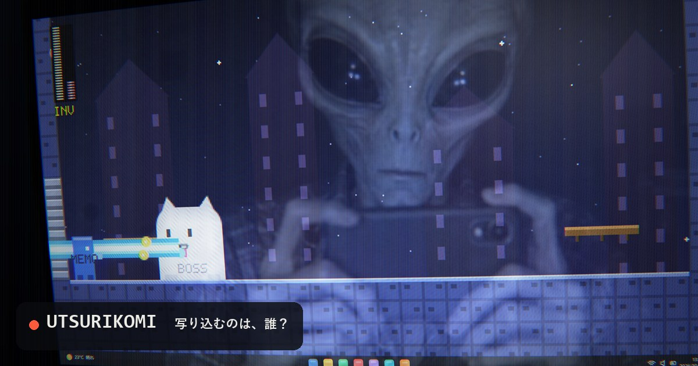

# UTSURIKOMI

**https://beammanp.github.io/utsurikomi/**

画像を「PC画面をスマホで撮った写真」にするジェネレーターです。
斜めの角度、画素の格子とモアレ、ノートPCの枠、そしてガラスへの**写り込み**まで再現します。
写り込むのは、おじさんか、バケモノか、美女か、アニメ美少女か。

Turn any image into a phone photo of a PC screen — perspective, moiré, laptop bezel,
and a reflection of whoever is holding the phone. A tired dude? A monster? An alien?



## 特徴 / Features

- 画像の処理はすべてブラウザの中で行います。サーバーには送信しません  
  Everything runs in your browser. Images are never uploaded.
- 写り込みのプリセット8種類＋自分の画像  
  8 reflection presets, or use your own image
- 角度・寄り・レンズのゆがみ・モアレ・視野角・ノイズ・シャープなどを調整可能  
  Adjust angle, zoom, lens distortion, moiré, viewing-angle falloff, noise, sharpening and more
- 日本語 / English

## 仕組み / How it works

WebGL2 の2パスで描いています。

1. 入力画像を PC 画面として描き、カメラの位置から射影（ホモグラフィ）して斜めから撮った形にする
2. 画面の RGB 画素の格子をカメラの画素で標本化して、モアレを自然に出す
3. 「カメラから画面へ下ろした垂線の足」＝鏡に自分が写る点を基準に、写り込みを足す
4. スマホカメラの癖（色ずれ・やりすぎシャープ・暗部のノイズ・周辺減光）を後処理で足す

ビルド不要の静的ファイルです。ローカルで動かす時は任意の静的サーバーで開いてください。

```
python -m http.server 8000
```

写り込みのプリセット画像は AI で生成したもので、実在の人物ではありません。  
Reflection presets are AI-generated and do not depict real people.
